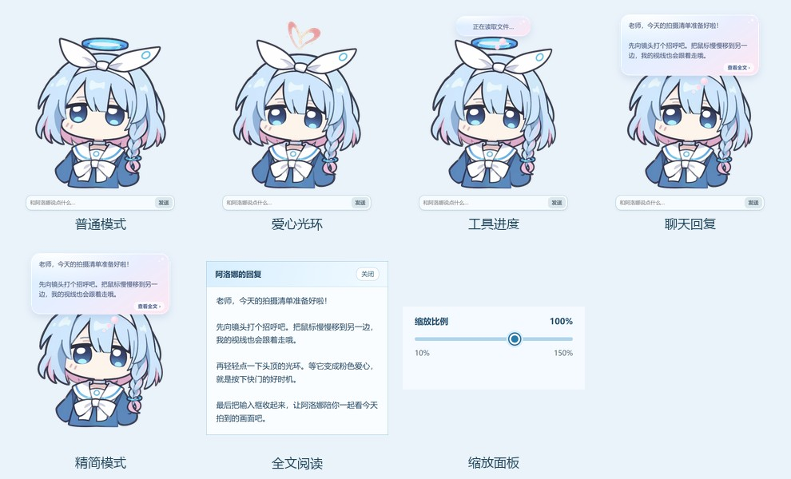
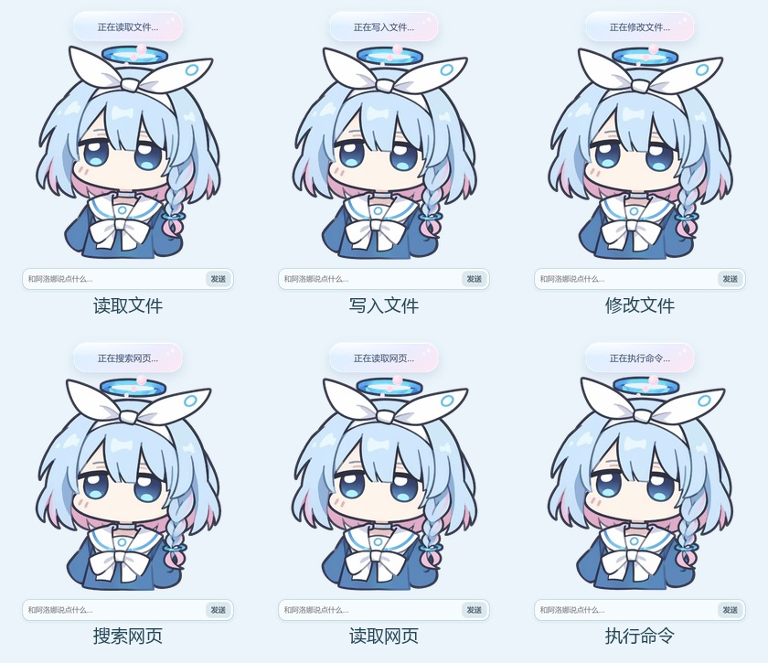

# OpenClaw 阿洛娜桌宠

一个运行在 Windows 桌面上的 Live2D 阿洛娜。她会跟随鼠标转头，按住会被捏扁，点一下头顶还能把蓝色光环变成爱心。连上本机 OpenClaw 后，你可以直接和她聊天，也可以让她在头顶的蓝白云朵气泡里显示当前会话的思考进度。

## 预览

阿洛娜会常驻桌面，跟随全局鼠标移动视线，并通过云朵气泡显示聊天回复和会话进度。

<p align="center">
  
</p>

<p align="center">
  
</p>

功能菜单支持精简模式、缩放和 Gateway 状态查看。工具调用时，气泡会显示简短的动作提示。

<p align="center">
  
</p>

<p align="center">
  
</p>

## Windows 快速开始（0.1.0）

先安装带 npm 的 **Node.js 24**。首次启动需要联网下载依赖和 Electron。只想在桌面上和阿洛娜互动时，可以直接启动桌宠；聊天和会话进度需要连接 OpenClaw Gateway。

1. **解压。** 在 GitHub Releases 的 Assets 中选择 `openclaw-arona-pet-0.1.0-windows.zip`，完整解压到可写目录，打开里面的 `openclaw-arona-pet-0.1.0` 文件夹。
2. **下载阿洛娜模型。** 按原作者动态中的说明下载并解压模型，将完整模型文件夹放到 `assets/阿洛娜桌宠模型/`。打开该目录应能直接看到 `.model3.json` 文件。[原作者的模型下载动态](https://b23.tv/G0ZGfmG)
3. **添加 Cubism Core。** 从官方 SDK 中取出 `Core/live2dcubismcore.min.js`，复制到 `assets/`，与模型文件夹并列。[下载 Live2D Cubism SDK for Web](https://www.live2d.com/en/sdk/download/web/)
4. **双击 `启动桌宠.cmd`。** 脚本会在首次启动时安装依赖并打开桌宠。以后双击同一文件即可，右键阿洛娜可打开功能菜单。

从 Git 克隆项目时，在项目根目录按第 2 至 4 步操作。

### 检查素材位置

```text
openclaw-arona-pet-0.1.0/
├─ 启动桌宠.cmd
└─ assets/
   ├─ live2dcubismcore.min.js
   └─ 阿洛娜桌宠模型/
      ├─ 阿洛娜dsh3.model3.json
      ├─ 阿洛娜dsh3.moc3
      ├─ 阿洛娜dsh3.4096/
      │  └─ texture_00.png
      └─ …
```

如果窗口打开后模型没有出现，先检查 `阿洛娜桌宠模型` 是否多套了一层文件夹。打开它应能直接看到一个 `.model3.json` 入口。若提示无法加载 Cubism Core，检查 `.js` 文件是否和 `assets/README.md` 放在同一层。

偏好命令行时，可在项目根目录依次运行 `npm ci` 和 `npm start`。已有安装也可继续使用项目旁边的 `阿洛娜桌宠模型` 和项目内的 `.runtime/live2dcubismcore.min.js`。桌宠会分别优先使用 `ARONA_MODEL_DIR` 和 `ARONA_CUBISM_CORE` 指定的位置，其次查找 `assets`，最后查找旧位置。

## 桌宠操作

| 操作 | 效果 |
| --- | --- |
| 按住角色，再松手 | 阿洛娜被轻轻捏扁，松手回弹。按住拖动可移动桌宠。 |
| 点击头顶光环 | 蓝色光环变成粉色爱心，约 1.5 秒后恢复。 |
| 在桌面移动鼠标 | 阿洛娜的视线和头部跟随指针，开启鼠标穿透后仍会跟随。 |
| 右键角色或托盘图标 → **调整桌宠大小…** | 拖动滑块，在 10% 到 150% 之间实时缩放。方向键每次微调 1%，首次启动默认为 100%。 |
| 右键 → **精简模式** | 隐藏输入框，保留角色和头顶气泡。再次选择即可恢复。 |
| 单击托盘图标 | 显示桌宠并恢复鼠标互动。找不到角色时，右键托盘图标选择 **移回主屏幕**。 |

桌宠会把缩放比例、屏幕位置和精简模式自动保存到启动脚本旁的 `pet-settings.json`。下次打开时会沿用这三项设置。升级后首次打开会沿用旧版保存的位置。如果原显示器已断开，桌宠会回到当前可见的屏幕范围内。

要恢复默认设置，请从托盘菜单退出桌宠，删除 `pet-settings.json` 后重新启动。阿洛娜会以 100% 大小和普通模式出现在主屏幕右下角。

## 连接 OpenClaw

当前版本连接 Windows 本机的 Gateway，默认地址是 `ws://127.0.0.1:18789`。以下步骤适用于 Gateway 与桌宠运行在同一台 Windows 电脑上的情况。请先按上面的快速开始准备桌宠素材和运行依赖。

### 1. 确认 Gateway 已启动

在 PowerShell 中运行以下命令。如果电脑还没有安装或配置 OpenClaw，请先按[官方安装指南](https://docs.openclaw.ai/install)完成安装和初始化。

```powershell
openclaw --version
openclaw gateway status
```

如果 Gateway 已运行且 RPC 检查通过，记下状态输出中的探测地址和端口，然后继续下一步。如果 Gateway 没运行，按你的安装方式选一条命令执行。

- 已安装 OpenClaw Gateway 后台服务时，运行 `openclaw gateway start`，再运行 `openclaw gateway status` 确认状态。
- 未安装后台服务时，运行 `openclaw gateway run`。保持该 PowerShell 窗口打开，另开一个窗口执行后面的命令。

如果 Gateway 使用了 OpenClaw 的命名配置，请在启动、查询状态和设备配对时使用同一份配置。例如，使用 `openclaw --profile work gateway status` 和 `openclaw --profile work devices list` 检查名为 `work` 的配置。

### 2. 填写 gateway.json，然后双击启动

在 `启动桌宠.cmd` 所在目录，用记事本打开 `gateway.json`。如果目录里只有 `gateway.example.json`，把它复制一份并命名为 `gateway.json`。首次启动桌宠时也会自动从模板创建这个文件。

```json
{
  "port": 18789,
  "token": "",
  "password": ""
}
```

- `port` 填第 1 步查到的本机 Gateway 端口。它是 1 到 65535 之间的整数，使用默认端口时保留 `18789`。
- 使用令牌认证时，把 **Gateway 令牌**填进 `token` 的双引号中，`password` 留空。在 OpenClaw 2026.10.10 中，可在 Gateway 电脑的交互式终端运行 `openclaw gateway auth-token --show` 查看已配置的令牌。
- 使用密码认证时，把 **Gateway 密码**填进 `password` 的双引号中，`token` 留空。本机 Gateway 配置为免认证时，两项都留空。凭据里的双引号和反斜杠按 JSON 格式分别写成 `\"` 和 `\\`。

以 UTF-8 保存后，双击 `启动桌宠.cmd`。每次修改配置，都要在桌宠右键菜单选择 **退出**，再双击启动脚本。桌宠每次启动都读取同一个文件。

`gateway.json` 在本机明文保存你填写的凭据，适合放在只有你能访问的目录。分享、提交或打包项目时只带空白的 `gateway.example.json`。首次配对后，桌宠会另外用 Windows 加密存储保存设备凭据。

### 3. 批准首次设备配对

打开桌宠后，右键角色或托盘图标查看 Gateway 状态。如果已经显示 `Gateway：在线`，可以直接进行下一步。如果菜单提示需要配对，或显示离线，请在另一个 PowerShell 窗口用管理该 Gateway 的 OpenClaw CLI 查看请求。

```powershell
openclaw devices list
```

在待批准请求中找到 `Arona Desktop Pet`，核对它是你刚启动的桌宠，然后复制对应的请求 ID。桌宠会请求 `operator.read` 和 `operator.write` 权限，用于读取会话状态和发送聊天消息。

```powershell
$requestId = Read-Host '粘贴桌宠配对请求的 ID'
openclaw devices approve $requestId
```

批准后，从菜单退出桌宠，再双击 `启动桌宠.cmd`。设备配对凭据会保存在本机的加密存储中，后续启动会复用。

### 4. 验证聊天与气泡

1. 右键桌宠，确认菜单显示 `Gateway：在线`。
2. 在底部输入框发送「你好」。如果输入框被隐藏，先在功能菜单关闭 **精简模式**。收到模型回复后，头顶会显示蓝白云朵气泡。
3. 如果还想验证会话进度，在 OpenClaw 中发起一个会话任务。对于支持公开思考摘要的模型，可在要观察的会话中发送 `/reasoning on` 或 `/reasoning stream`，再发起任务。气泡会在 Gateway 提供可见摘要时显示相应内容。也可以让会话读取一个文件，观察气泡是否显示「正在读取文件…」。工具进度在关闭思考摘要时也会显示。

### 连接不上时怎么查

| 现象 | 排查方法 |
| --- | --- |
| `openclaw` 命令找不到 | 确认已在这台 Windows 电脑上安装 OpenClaw CLI，然后重新打开 PowerShell 检查 `openclaw --version`。 |
| Gateway 状态检查失败 | 先确认 Gateway 服务或前台窗口仍在运行。核对状态输出里的端口和桌宠使用的端口。修改 `gateway.json` 的 `port`，退出旧实例后再双击启动。 |
| CLI 可连接，桌宠提示检查凭据 | 确认 Gateway 使用的是令牌还是密码。在启动脚本旁的 `gateway.json` 中只填写对应的凭据，保存并重开桌宠。若菜单提示配置格式错误，请对照空白模板检查双引号、逗号和端口。 |
| 离线且有待批准请求 | 在同一个 Gateway 的配置下运行 `openclaw devices list`，批准对应的 `Arona Desktop Pet` 请求，然后重开桌宠。 |
| 离线且没有待批准请求 | 优先核对端口和认证。桌宠需要先到达正确的 Gateway，才可能出现配对请求。 |
| 已在线，消息一直没有回复 | 在 OpenClaw 中用同一 Gateway 发送一条测试消息，确认模型和提供商账号可用。 |
| 已在线，能聊天但气泡没有思考摘要 | 查看正在运行的会话是否开启 `/reasoning`，模型是否提供可见摘要，以及 Gateway 版本是否支持下文的会话订阅接口。 |

### 云朵气泡里会显示什么？

- **思考进度**。桌宠跟随一个正在运行且有权查看的会话。多个会话同时运行时，优先选最早开始的一个；缺少开始时间时取列表第一项，跟随到结束再切换。
- **可见摘要**。当会话的 `reasoningLevel` 为 `on` 或 `stream`，且 Gateway 提供了可见思考文本时，气泡显示简短标题或最近一行。
- **工具进度**。气泡根据当前任务的工具事件显示一句动作，例如「正在读取网页…」。工具返回后显示「网页读取结束，等待下一步…」，直到收到新的进度。已知的工具显示中文名称，其他工具统一显示「正在调用工具…」。气泡只展示动作，省略参数、路径、输出和日志。首次收到可展示的进度前显示「正在处理…」。
- **聊天回复**。底部输入框使用桌宠专属会话 `agent:main:arona-desktop-pet`。回复到达时显示在同一个云朵里，默认预览最多四行。点 **查看全文** 会在桌宠旁打开阅读卡，支持滚动、选择和复制，按 `Esc` 或点 **关闭** 即可收起。最终回复送达后，短回复显示 8 秒，长回复显示 15 秒。鼠标停在气泡上或阅读卡打开时暂停计时，离开后继续。气泡消失后，可从桌宠右键菜单或托盘菜单选择 **查看上次回复**。回看保留本次启动后最近一条已完成的聊天回复。普通模式和精简模式都使用这个气泡，气泡出现时模型大小保持不变。

实时会话跟随使用 OpenClaw `2026.10.10` 的 `sessions.subscribe`、`activeOnly` 和单会话订阅接口。排查连接问题时，先检查菜单中的状态、端口和配对，再核对 Gateway 的版本与会话读取权限。

## 开发与测试

```powershell
npm test               # 使用本机测试网关验证会话选择、事件过滤及回复
node test/window.mjs   # 使用真实模型和隔离的 Electron 窗口验证交互
```

窗口测试需要准备好模型和 Core，截图保存在 `.runtime/proof/`。仓库包含已构建的渲染包。修改 `view/model.js` 后，请先准备指定版本的 Cubism Framework，再运行 `npm run build:view`。详见[渲染器构建说明](view/README.md)。

## 致谢与素材使用

阿洛娜出自《蔚蓝档案》。模型随附说明标注角色版权归 NEXON / Yostar，建模师为**卡尔莫钦**，模型仅供个人使用，请勿商用或再分发。使用模型时请保留下载包中的 `说明.txt`。

捏捏反馈与爱心光环交互参考了 `dsh-arona-pet@1.0.0`。装有该 DSH 插件时，桌宠会读取本机的点击音效；缺少音效时仍可体验动画。

Live2D Cubism Core 遵循 Live2D 的许可条款。渲染包使用的 Cubism Web Framework 附有[第三方许可说明](view/CubismFramework-LICENSE.md)。
